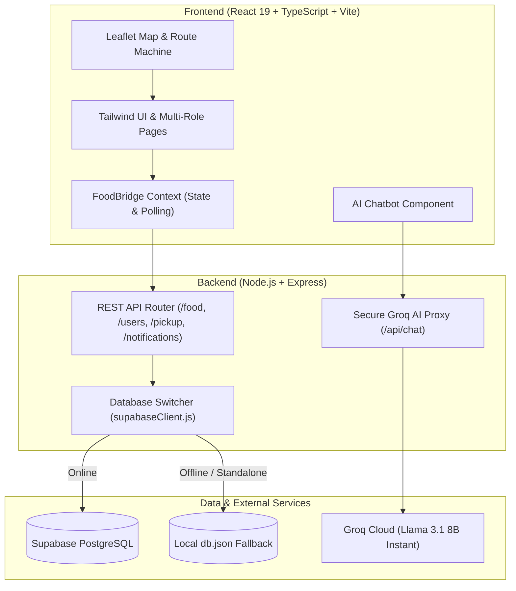

# FoodBridge – Food Donation and Redistribution Platform

[](https://opensource.org/licenses/MIT)
[](https://nodejs.org/)
[](https://react.dev/)
[](https://www.typescriptlang.org/)
[](https://tailwindcss.com/)
[](https://supabase.com/)

FoodBridge is a full-stack, community-driven food donation and redistribution platform designed to bridge surplus food from hotels, restaurants, caterers, and individuals with local NGOs and communities facing food insecurity.

---

## 📌 Problem Statement

Every year, millions of tons of edible food are wasted from commercial banquets, restaurants, and catering events, while millions of individuals experience nutritional deficits and hunger. The primary bottleneck is logistical:
- Donors lack an immediate, verified channel to alert nearby volunteers before cooked food spoils.
- NGOs face uncertain pickup timings, lack real-time cargo routing, and struggle to estimate food safety windows.
- Traditional paper or group-chat coordination lacks transparency, traceability, and accountability.

**FoodBridge** solves this by providing a unified digital coordination engine featuring live map routing, automated donor-to-NGO matching, dynamic expiry calculations, and AI-powered food rescue assistance.

---

## 🌟 Key Features

### 🏢 Multi-Role Portals
- **Donor Portal**: Enables banquets, restaurants, caterers, and individuals to post surplus meals with photos, portion counts, packaging types, and precise geolocation coordinates.
- **NGO Dashboard**: Verified non-profits can browse available food listings in real time, claim parcels, view pickup addresses, and track real-time delivery progress.
- **Admin Command Center**: Oversee platform activity, manage user verifications, approve NGO accreditation IDs, and monitor network-wide redistribution metrics.

### 🗺️ Interactive Geolocation & Navigation
- Real-time map powered by **Leaflet** and **React-Leaflet**.
- Location picker map with coordinate pinpointing for donors.
- Turn-by-turn routing powered by **Leaflet Routing Machine** connecting NGOs directly to donor locations.

### 🤖 AI Food Rescue Assistant
- Powered by **Groq LLM (`llama-3.1-8b-instant`)**.
- Analyzes food preparation times and scenarios (e.g., buffet dishes, rice, curries) to compute:
  - Food Category (Cooked / Raw / Packaged)
  - Estimated Safe Shelf Life
  - Recommended Safe Consumption Window
  - Optimal Pickup Window
- Integrated Web Speech API (`SpeechSynthesis`) for voice-guided food safety assistance.
- Secure server-side API proxy ensuring zero frontend API key leakage.

### 🏆 Gamification & Impact Analytics
- **Leaderboards**: Real-time points scoring for high-frequency donors and top-performing NGO distribution partners.
- **Achievement Badges**: Community recognition badges (*"Golden Heart"*, *"Surplus Slayer"*, *"Buffet Hero"*, *"Midnight Angels"*).
- **Carbon & Meal Metrics**: Automated conversion of rescued food kilograms into meals served and estimated CO₂e emission reductions.

### 🌐 Multilingual & Inclusive UI
- Dynamic 5-language localization (**English, Hindi, Telugu, Tamil, Kannada**) with persistent selection.
- High-contrast **Dark / Light mode** theme support.
- Fully responsive across desktop, tablet, and mobile browsers.

### 🛡️ Resilient Dual-Mode Database
- **Supabase Cloud Integration**: Built for PostgreSQL with instant schema queries.
- **Offline Zero-Config Fallback**: Custom server-side `QueryBuilder` engine backed by local JSON storage (`db.json`) that automatically activates when cloud credentials are not supplied, ensuring seamless development and offline demos.

---

## 🏗️ System Architecture



---

## 💻 Tech Stack

| Layer | Technologies |
| :--- | :--- |
| **Frontend** | React 19, TypeScript, Vite, Tailwind CSS v4, Lucide React, Motion |
| **Maps & Routing** | Leaflet, React-Leaflet, Leaflet Routing Machine |
| **AI & Voice** | Groq SDK (`llama-3.1-8b-instant`), Web Speech API |
| **Backend** | Node.js, Express 5, CORS, Dotenv, Multer |
| **Database** | Supabase (PostgreSQL), Custom JSON QueryBuilder fallback |
| **Tooling** | npm, Git, GitHub Actions, Vercel SPA routing |

---

## 📂 Project Structure

```
FoodBridge-Food-Donation-Platform/
├── .gitignore                          # Root git ignore rule definitions
├── .env.example                        # Global environment configuration template
├── README.md                           # Project documentation
│
├── backend/                            # Node.js Express Backend
│   ├── .env.example                    # Backend environment template
│   ├── db.json                         # Local resilient database fallback
│   ├── package.json                    # Backend dependencies & start scripts
│   ├── server.js                       # Express REST API & Groq AI proxy route
│   └── supabaseClient.js               # Supabase client with QueryBuilder fallback
│
└── foodshare-react/
    └── frontendpage/                   # React 19 + Vite Frontend Application
        ├── .env.example                # Frontend environment template
        ├── index.html                  # HTML entry point
        ├── package.json                # Frontend dependencies & Vite scripts
        ├── tsconfig.json               # TypeScript compiler options
        ├── vercel.json                 # SPA rewrite configuration
        ├── vite.config.ts              # Vite build configuration
        └── src/
            ├── App.tsx                 # Root application component & role modal
            ├── main.tsx                # React DOM mount point
            ├── types.ts                # TypeScript data interfaces
            ├── index.css               # Tailwind CSS theme rules
            ├── components/             # Reusable UI widgets
            │   ├── AIChatbot.tsx       # Groq AI food rescue chat & voice assistant
            │   ├── Charts.tsx          # Impact visualization metrics
            │   ├── JudgePanel.tsx      # Quick role & scenario tester
            │   ├── LocationPickerMap.tsx # Interactive coordinates selector
            │   ├── MapComponent.tsx    # Leaflet live route & donor map
            │   └── Navbar.tsx          # Navigation, language switcher & theme toggle
            ├── constants/
            │   └── translations.ts     # 5-language localization dictionary
            ├── context/
            │   └── FoodBridgeContext.tsx # Global state, polling & API client
            └── pages/                  # Application views
                ├── Home.tsx            # Hero landing & live surplus feed
                ├── About.tsx           # Mission & food waste awareness
                ├── Dashboards.tsx      # Donor / NGO / Admin command panels
                ├── Donations.tsx       # Surplus meal submission form
                ├── Impact.tsx          # Carbon savings & meal metrics
                ├── Leaderboard.tsx     # Gamified community rankings
                ├── PickupDetail.tsx    # Claimed cargo tracking view
                ├── Registration.tsx    # Organization onboard form
                └── ContactFAQ.tsx      # Help center & FAQ accordion
```

---

## 🚀 Getting Started

### Prerequisites
- [Node.js](https://nodejs.org/) (v18.0.0 or higher recommended)
- [npm](https://www.npmjs.com/) (bundled with Node.js)
- A modern web browser with geolocation support

---

### 1. Clone the Repository
```bash
git clone https://github.com/bushrafaizi1162529-pixel/FoodBridge-Food-Donation-Platform.git
cd FoodBridge-Food-Donation-Platform
```

---

### 2. Backend Setup
1. Navigate to the backend directory:
   ```bash
   cd backend
   ```
2. Install dependencies:
   ```bash
   npm install
   ```
3. Configure environment variables:
   ```bash
   cp .env.example .env
   ```
   *Edit `.env` if you have Supabase or Groq API credentials. If left blank, the backend will automatically run in local JSON database mode.*
4. Start the backend server:
   ```bash
   npm start
   ```
   The backend API will run on **`http://localhost:5000`**.

---

### 3. Frontend Setup
1. Open a new terminal and navigate to the frontend directory:
   ```bash
   cd foodshare-react/frontendpage
   ```
2. Install dependencies:
   ```bash
   npm install
   ```
3. Configure environment variables (optional):
   ```bash
   cp .env.example .env
   ```
4. Start the Vite development server:
   ```bash
   npm run dev
   ```
5. Open your browser and visit: **`http://localhost:3000`**

---

## ⚙️ Environment Variables

### Backend (`backend/.env`)
| Variable | Description | Default / Required |
| :--- | :--- | :--- |
| `PORT` | Port for Express server | `5000` |
| `SUPABASE_URL` | Supabase project URL | Optional (local fallback) |
| `SUPABASE_ANON_KEY` | Supabase anonymous API key | Optional (local fallback) |
| `GROQ_API_KEY` | Groq API key for food safety AI assistant | Optional (mock reply if empty) |
| `ALLOW_INSECURE_TLS` | Allow relaxed SSL certs during local dev | `false` |

### Frontend (`foodshare-react/frontendpage/.env`)
| Variable | Description | Default |
| :--- | :--- | :--- |
| `VITE_API_URL` | Base URL of the backend API | `http://localhost:5000` |

---

## 👥 Project Team & Contributions

### **Bushra Faizi** ([@bushrafaizi1162529-pixel](https://github.com/bushrafaizi1162529-pixel))
- **Role**: Team Leader & Backend Developer
- **Key Contributions**:
  - **Architecture & Leadership**: Led project direction, feature scope, and technology roadmap.
  - **Database Engineering**: Architected database schema and integrated Supabase PostgreSQL client.
  - **Resilient Fallback Engine**: Engineered the server-side `QueryBuilder` and `db.json` synchronization mechanism to allow zero-config offline execution.
  - **RESTful API Development**: Implemented Express endpoints for `/food`, `/users`, `/pickup`, `/register`, and `/notifications`.
  - **Full-Stack Integration**: Integrated frontend asynchronous data fetching and polling with the backend services.
  - **Security & AI Proxy**: Implemented secure server-side AI proxy routes protecting Groq credentials from client-side exposure.

---

## 📷 Screenshots
*Screenshots will be added following deployment verification.*

---

## 🔮 Future Improvements

- [ ] **Push Notifications**: Integrate Web Push and SMS notifications for immediate urgent food pickup alerts.
- [ ] **Fleet Route Optimization**: Add Dijkstra / TSP clustering for NGO delivery fleets picking up from multiple donors simultaneously.
- [ ] **IoT Cold-Chain Telemetry**: Integrate temperature sensor telemetry for perishable milk, dairy, and dessert rescue.
- [ ] **Volunteer Verification**: In-app QR code verification on food handoff between donor and volunteer.

---

## 📄 License

This project is licensed under the [MIT License](LICENSE).

